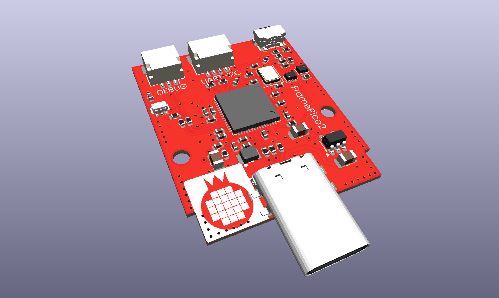
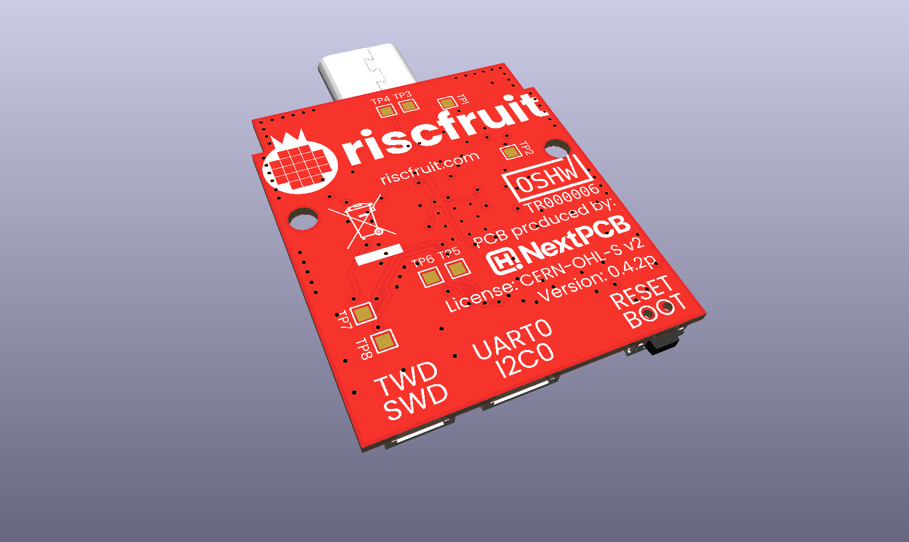

# FramePico2-Expansion-Card
A USB Type-C devboard dongle based on RP2354, with 2 ports, in expansion card form factor. Soon available on Crowd Supply.

### Gallery

### License
Copyright (c) 2026, Riscfruit Laboratory. This open source hardware is released under [CERN-OHL-S-2.0](LICENSE).
